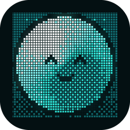

<p align="center">
  
</p>

<p align="center">
  
</p>

<p align="center">
  <strong>A little buddy that lives on your screen and keeps you on track.</strong>
</p>

<p align="center">
  <a href="https://github.com/KenKaiii/Roamies/releases/latest"></a>
  <a href="https://github.com/KenKaiii/Roamies/stargazers"></a>
  <a href="https://github.com/KenKaiii/Roamies/releases"></a>
  <a href="LICENSE"></a>
  <a href="https://youtube.com/@kenkaidoesai"></a>
  <a href="https://www.skool.com/raid"></a>
</p>

Roamies is a little AI buddy that lives on your desktop. It stays by your cursor, talks back in its own
voice, keeps track of what you said you'd do and nudges you when it's due.

> [!TIP]
> **Want to build your own apps with AI?** A free 7-day build challenge and 20+ step-by-step projects are in my free community: **[skool.com/raid](https://www.skool.com/raid)**

> ⭐ **If Roamies keeps you on track, give it a star.** It's the main way other people find it.

## Why Roamies

- **Talk, don't type.** Hold ⌃⌥ (Ctrl+Alt on Windows and Linux), say it, let go. On macOS and Windows, circle something with the cursor while you talk and it sees what you mean.
- **Or type.** Tap ⌥⌘ (Ctrl+Shift on Windows and Linux) and a small text field opens beside your cursor. Type, press Enter.
- **It talks back.** Spoken replies in its own voice, with real feeling, through [Fish Audio](https://fish.audio).
- **It remembers.** What you said you'd do, reminders down to the second, and what matters to you.
- **It draws on your screen.** Rings the exact button to click, walks you through each step, and sketches answers beside what you're reading.
- **It does the clicking.** Opens apps, sites and files, and on macOS and Windows clicks or types in other apps for you.
- **Your subscriptions.** Sign in with Claude or ChatGPT, or use an API key (Gemini, Grok, Kimi Code and more).

| Pick your Roamie | What you get                                            |
| ---------------- | ------------------------------------------------------- |
| **JARVIS**       | **A glowing sphere of light that ripples as it speaks** |
| Roamie           | The original: a tiny glowing pixel creature             |
| Anime Girl       | A pixel anime girl                                      |
| Sarah            | A pixel woman                                           |
| Adrian           | A pixel man                                             |

<sub>Each one has its own name, voice and animations, in three sizes: Default, Small, or Cursor, a pixel pointer that rides along with your mouse.</sub>

## JARVIS shows you how

<p align="center">
  
</p>

Ask how to do something in any app. JARVIS turns into its cursor, rings the exact button on your real screen,
says the step out loud and waits for your click before showing the next one.

## JARVIS explains anything

<p align="center">
  
</p>

Ask about whatever you're looking at. JARVIS sketches the answer right beside it while it talks: cards, graphs,
timelines, photos, molecules and turning 3D models, all in its own glowing ink. Ask it to change any part, or
clear it all in one go. It also picks the picture that fits the question by itself: flow diagrams, tables, bar
charts, maps, worked maths, geometry figures, photos with their parts named, 3D models whose parts move, and
quizzes you answer with a click.

## Also included

- **The Roamies panel:** click the menu bar or tray icon (on Linux, **Open Panel** in its menu) for what it's doing, what it remembers, and every setting.
- **Safe by default:** file edits, commands and app control stay off until you turn them on, and risky steps always ask.
- **Shows its work:** every tool plays its own animation, so you can see what it's doing.
- **Where keys live:** your Fish Audio key stays in the macOS Keychain (encrypted with Windows DPAPI on Windows, in your desktop's keyring on Linux). AI sign-ins are stored in `~/.gg/auth.json`, shared with GG Coder.
- **Out of the way:** no Dock or taskbar button, a shortcut shows or hides it (see the table), Esc stops a reply.
- **Updates itself:** updates are signature-checked before they install, then it restarts itself. The Windows installer isn't code-signed yet, so SmartScreen warns the first time. On Linux only the AppImage updates itself.
- **Quick setup:** permissions, sign-in and a short chat so it gets to know you.

|                        | macOS                      | Windows                     | Linux (beta)                       |
| ---------------------- | -------------------------- | --------------------------- | ---------------------------------- |
| Talk to it             | Yes, best on macOS 26+     | Yes, speech runs on your PC | Yes, speech runs on your PC        |
| Circle while talking   | Yes                        | Yes                         | No                                 |
| Spoken replies         | Yes, with a Fish Audio key | Yes, with a Fish Audio key  | Yes, with a Fish Audio key         |
| Memory and reminders   | Yes                        | Yes                         | Yes                                |
| Read windows and point | Yes                        | Yes                         | Points from screenshots only       |
| Cards and diagrams     | Yes                        | Yes                         | Yes                                |
| Click and type in apps | Yes                        | Yes                         | No                                 |
| Ask about an area      | Yes (⌃⌥A)                  | Yes (Ctrl+Shift+A)          | No                                 |
| Show or hide           | ⌃⌥S                        | Ctrl+Shift+S                | Ctrl+Alt+S, or a key you bind\*    |
| Talk shortcut          | Hold ⌃⌥                    | Hold Ctrl+Alt               | Hold Ctrl+Alt, or a key you bind\* |
| Type shortcut          | Tap ⌥⌘                     | Tap Ctrl+Shift              | Tap Ctrl+Shift, or a key you bind\* |
| Updates itself         | Yes                        | Yes                         | AppImage only                      |

<sub>\* On Wayland (the default on Ubuntu, Fedora and KDE), apps can't grab keys, so you bind Roamies' commands to keys
in your desktop's keyboard settings. [Linux (beta)](#linux-beta) shows how.</sub>

<sub>Before macOS 26, talking uses Apple's older speech recognizer, which needs Siri or Dictation turned on.</sub>

<sub>On Windows, Roamies reads other apps through UI Automation and finds words on screen with Windows' own text
recognition (it needs a Windows language with text recognition, which most have). It can't type or click in apps
running as administrator, and it borrows your cursor for real clicks, keys and scrolling, giving it back when it's done.
Windows also leaves Roamies out of every screen capture, so it won't show in your screenshots or screen shares.</sub>

<sub>Spoken replies are billed to your own Fish Audio account; the panel shows what each voice model costs. Voice on
Windows and Linux uses [NVIDIA Parakeet TDT 0.6B v3](https://huggingface.co/nvidia/parakeet-tdt-0.6b-v3)
([CC BY 4.0](https://creativecommons.org/licenses/by/4.0/)), in the ONNX export by
[istupakov](https://huggingface.co/istupakov/parakeet-tdt-0.6b-v3-onnx), run with
[parakeet-rs](https://github.com/altunenes/parakeet-rs). The model (about 670 MB) downloads once at setup and isn't bundled.</sub>

## Get started

1. Install Roamies:

   **macOS (Apple silicon or Intel):** [Download the latest release](https://github.com/KenKaiii/Roamies/releases/latest) and open the `.dmg` for your Mac (`aarch64` for Apple silicon, `x64` for Intel). Requires macOS 13.5 or later.

   **Windows:** [Download the latest release](https://github.com/KenKaiii/Roamies/releases/latest) and run the `.exe` installer. Requires Windows 10 or later. It isn't code-signed yet, so Windows shows a SmartScreen warning the first time: click **More info**, then **Run anyway**.

   **Linux (beta, x86_64):** [Download the latest release](https://github.com/KenKaiii/Roamies/releases/latest) and pick one:
   the `.deb` (Ubuntu, Debian, Mint, Pop!_OS: `sudo apt install ./Roamies_*_amd64.deb`), the `.rpm` (Fedora,
   openSUSE: `sudo dnf install ./Roamies-*.x86_64.rpm`), or the `.AppImage` (any distro: `chmod +x` it and run it; only
   the AppImage updates itself). Needs glibc 2.38 or later: Ubuntu 24.04, Fedora 39, Debian 13 or newer. See
   [Linux (beta)](#linux-beta) for what works and how to set up shortcuts.

   **Development:** With Rust, Node.js 22+, the [Tauri prerequisites](https://v2.tauri.app/start/prerequisites/) and, on macOS, the Xcode Command Line Tools installed:

   ```bash
   git clone https://github.com/KenKaiii/Roamies.git
   cd Roamies/showcase/tauri
   (cd sidecar && npm ci && npm test)
   ./build.sh dev        # debug build
   ./build.sh            # release bundle for this OS
   ```

2. Open the app, follow the setup guide, pick your Roamie, and hold ⌃⌥ (Ctrl+Alt on Windows and Linux) to say hi.

<sub>The first time you sign in with Claude, Roamies downloads Claude Code (about 140 MB). On Windows and Linux, the voice model (about 670 MB) downloads once at setup.</sub>

## Linux (beta)

Roamies on Linux is a beta: it runs on GNOME, KDE Plasma and other desktops, on Wayland or X11, but it's been tested
far less than on macOS and Windows. Bug reports with your distro, desktop and session (`echo $XDG_SESSION_TYPE`) help.

**What works:** the Roamie on screen, the panel, typed and spoken questions (speech runs on your computer), spoken
replies, memory and reminders, whole-screen screenshots and pointing at things on them, cards and diagrams, files and
commands, Open at Login, and in-app updates for the AppImage (a `.deb` or `.rpm` copy opens the download page instead).

**Not yet:** reading or working other apps, Ask About an Area, circling while talking, and the Cursor size on Wayland.

**Wayland** (the default on Ubuntu, Fedora and KDE) doesn't let apps grab keys or see the pointer over other apps, so:

- Shortcuts are commands you bind to keys yourself. The panel's **Behavior** page lists them with a **Copy** button
  (for an AppImage they start with its path instead of `roamies`):

  | Command            | What it does                                        |
  | ------------------ | --------------------------------------------------- |
  | `roamies --talk`   | Start listening; press again (or pause) to send     |
  | `roamies --summon` | Show or hide the Roamie                             |
  | `roamies --ask`    | Ask by typing                                       |
  | `roamies --list`   | Show your list                                      |
  | `roamies --panel`  | Open the panel                                      |

  - **GNOME:** Settings › Keyboard › View and Customize Shortcuts › Custom Shortcuts › **+**, then the command and your keys.
  - **KDE Plasma:** System Settings › Keyboard › Shortcuts › **Add New** › **Command or Script**.
  - **Sway:** `bindsym Ctrl+Alt+space exec roamies --talk` in `~/.config/sway/config`.
  - **Hyprland:** `bind = CTRL ALT, SPACE, exec, roamies --talk` in `~/.config/hypr/hyprland.conf`.
- Walkthroughs play their steps one after another instead of waiting for your clicks.
- Screenshots go through your desktop's screenshot portal, which may ask you to allow them.

On X11 sessions the shortcuts work as on Windows (hold Ctrl+Alt to talk, Ctrl+Alt+S to show or hide).

**Troubleshooting:**

- **No tray icon on GNOME:** GNOME hides tray icons unless the
  [AppIndicator extension](https://extensions.gnome.org/extension/615/appindicator-support/) is on (Ubuntu has it on
  already). Without it, open Roamies again from your apps (or run `roamies --panel`) to get the panel.
- **The overlay draws black or not at all (often NVIDIA):** start Roamies with `WEBKIT_DISABLE_DMABUF_RENDERER=1`.
- **"Couldn't save the key" for Fish Audio:** Roamies keeps it in your keyring with `secret-tool`. Install it
  (`libsecret-tools` on Debian and Ubuntu, `libsecret` on Fedora and Arch) and make sure a keyring (GNOME Keyring,
  KWallet or KeePassXC) is running.
- **It can't hear you:** check the input device picked in your sound settings; Roamies uses the default microphone.
- **With fractional scaling** the Roamie may look a little soft, and pointing a little off.

## Privacy

Roamies has no analytics, and nothing is collected by the developer. Your messages, and screenshots when you ask
about the screen, go to the AI provider you pick. [PRIVACY.md](PRIVACY.md) lists what's sent where.

## Uninstall

**macOS:**

1. Turn off **Open at login** (panel > Behavior), then quit Roamies from the menu bar.
2. Drag Roamies from Applications to the Trash.
3. Delete `~/.gg/sidekick` and `~/.gg/sidekick.json`. Keep `~/.gg/auth.json` if you use GG Coder.
4. Open Keychain Access, search for "Roamies" and delete the Fish Audio key.

**Windows:**

1. Turn off **Open at login** (panel > Behavior), then uninstall Roamies from Settings > Apps.
2. Delete `%USERPROFILE%\.gg\sidekick` and `%USERPROFILE%\.gg\sidekick.json`. Keep `auth.json` if you use GG Coder.
3. Delete the voice model folder, `%LOCALAPPDATA%\Roamies\models`.

**Linux:**

1. Turn off **Open at login** (panel > Behavior), then quit Roamies from its tray menu (or the panel's About page).
2. Remove the package (`sudo apt remove roamies` or `sudo dnf remove roamies`), or delete the AppImage.
3. Delete `~/.gg/sidekick` (the voice model is in `~/.gg/sidekick/models`) and `~/.gg/sidekick.json`. Keep
   `~/.gg/auth.json` if you use GG Coder.
4. Delete the Fish Audio key: `secret-tool clear service com.kenkai.roamies account fish-audio`.

## Build with the framework

Every Roamie's brain is a [gg-framework](https://github.com/KenKaiii/gg-framework) agent running in a Node
sidecar. Want to build your own? Install just what you need.

- [**@kenkaiiii/gg-ai**](https://github.com/KenKaiii/gg-framework/blob/main/packages/gg-ai/README.md): Connect to AI providers and stream responses.
- [**@kenkaiiii/gg-agent**](https://github.com/KenKaiii/gg-framework/blob/main/packages/gg-agent/README.md): Build agents that use your tools and work through tasks.
- [**@kenkaiiii/gg-core**](https://github.com/KenKaiii/gg-framework/blob/main/packages/gg-core/README.md): Model selection, authentication, and local model discovery.

For your own agent, start here:

```bash
npm install @kenkaiiii/gg-ai @kenkaiiii/gg-agent
```

The package links above cover setup and usage. Roamies is licensed under [AGPL-3.0](LICENSE): you can build
on it, and if you distribute your changes or run them as a network service, you share their source under
the same license.

## Contributing

Bug reports, ideas and pull requests are welcome. [Open an issue](https://github.com/KenKaiii/Roamies/issues)
to get started, read [CONTRIBUTING.md](CONTRIBUTING.md) before a pull request, and report security problems as described in [SECURITY.md](SECURITY.md).

## Learn with me

New to building with AI? Start in **[RAID](https://www.skool.com/raid)**, my free community:

- A free 7-day challenge: build your first app, one short lesson a day
- 20+ step-by-step projects you can build yourself

## Star history

<a href="https://star-history.com/#KenKaiii/Roamies&Date">
  <picture>
    <source media="(prefers-color-scheme: dark)" srcset="https://api.star-history.com/svg?repos=KenKaiii/Roamies&amp;type=Date&amp;theme=dark">
    
  </picture>
</a>

<p align="center">If Roamies is useful to you, ⭐ star the repo so more people find it.</p>
